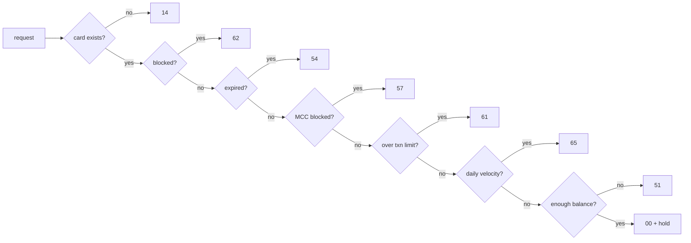

# card-auth-simulator

[](https://github.com/HelenArams/card-auth-simulator/actions/workflows/ci.yml)
[](LICENSE)

A tiny issuer-side card authorization service: you send it a purchase, it runs a few rules and answers with an ISO 8583 response code, the way an issuer host would. Spring Boot 3, Java 17, H2 in memory, nothing to set up.

## Why

I work on card payments, and a lot of my day is spent looking at authorization logs and asking "why was this a 51 and not a 61?". I wanted a small thing I could poke at locally that behaves roughly like the issuer side, with the decline order written down in code instead of living in my head. It's also a decent playground for idempotency and hold/reversal handling, which is where real bugs tend to hide.

It works for what I needed. It is **not** production-ready: no auth, no FX, no capture/settlement, one in-memory database.

## How a request is decided

Rules run in a fixed order and the first one that declines wins. If nobody declines, the request is approved, gets a 6-character auth code and the amount is held on the card.



| Code | Meaning | When |
|------|---------|------|
| `00` | Approved | everything passed; amount is held |
| `14` | Invalid card | token not found |
| `62` | Restricted card | card status is `BLOCKED` |
| `54` | Expired card | past the **end** of the expiry month, or status `EXPIRED` |
| `57` | Not permitted to cardholder | merchant MCC on the blocklist (default `7995` gambling, `6051` quasi-cash) |
| `61` | Exceeds amount limit | single amount above `per-transaction-limit` (default 750.00) |
| `65` | Exceeds activity limit | 10 approvals today already, or today's approved total + this amount > card's daily limit |
| `51` | Insufficient funds | amount > balance minus existing holds |

Limits live in `application.yml` under `cardauth.rules`. Amounts everywhere are in minor units (cents).

## Running it

```bash
mvn spring-boot:run
# or
make docker-build docker-run
```

Then:

- Swagger UI: http://localhost:8080/swagger-ui.html
- H2 console: http://localhost:8080/h2-console (JDBC URL `jdbc:h2:mem:cardauth`, user `sa`)
- Metrics: http://localhost:8080/actuator/metrics/authorizations

### Demo cards

The cards are seeded from `src/main/resources/data.sql`. Only a token and the last 4 digits are stored, never the PAN; the numbers in brackets are the usual public test PANs they stand for.

| Token | Card | State |
|-------|------|-------|
| `tok_visa_1111` | Visa (4111 1111 1111 1111) | active, 2,500.00 balance, 1,000.00 daily limit |
| `tok_mc_4444` | Mastercard (5555 5555 5555 4444) | active, only 15.00 left |
| `tok_visa_5556` | Visa (4000 0566 5566 5556) | blocked |
| `tok_visa_4242` | Visa (4242 4242 4242 4242) | expired 2021-06 |

## Trying the codes

A small helper so the examples stay short:

```bash
auth() { # token amount mcc [idempotency-key]
  local key=(); [ -n "$4" ] && key=(-H "Idempotency-Key: $4")
  curl -s -X POST localhost:8080/v1/authorizations \
    -H 'Content-Type: application/json' "${key[@]}" \
    -d "{\"cardToken\":\"$1\",\"amount\":$2,\"currency\":\"EUR\",
         \"merchant\":{\"id\":\"M-1\",\"mcc\":\"$3\",\"country\":\"NL\"}}"
  echo
}
```

```bash
auth tok_visa_1111 1250  5411   # 00 approved
auth tok_nobody    1000  5411   # 14 card not found
auth tok_visa_5556 1000  5411   # 62 blocked
auth tok_visa_4242 1000  5411   # 54 expired
auth tok_visa_1111 1000  7995   # 57 gambling MCC
auth tok_visa_1111 80000 5411   # 61 over the per-transaction limit
auth tok_mc_4444   5000  5411   # 51 insufficient funds

# 65: spend most of the daily limit, then try again
auth tok_visa_1111 60000 5411   # 00
auth tok_visa_1111 60000 5411   # 65
```

An approval looks like this:

```json
{
  "id": "6f1c2a8e-3f0b-4d0a-9a55-2a4c1c7f9b10",
  "cardToken": "tok_visa_1111",
  "amount": 1250,
  "currency": "EUR",
  "merchant": { "id": "M-1", "mcc": "5411", "country": "NL" },
  "status": "APPROVED",
  "approved": true,
  "responseCode": "00",
  "reason": "Approved",
  "authCode": "K7Q2MX",
  "createdAt": "2023-06-16T19:02:11.481Z"
}
```

Declines still come back as `201` - the decision was made and stored, the answer is in `responseCode`. HTTP errors are reserved for requests that are actually wrong, and those come back as RFC 7807 `application/problem+json` (400 validation, 404 unknown id, 409 bad reversal or reused key, 422 currency mismatch).

Other endpoints:

```bash
curl -s localhost:8080/v1/authorizations/{id}                # fetch a decision
curl -s -X POST localhost:8080/v1/authorizations/{id}/reverse # release the hold
curl -s localhost:8080/v1/cards/tok_visa_1111                 # masked card + held/available
```

### Retries

Acquirers retry on timeouts, and a naive retry means a second hold on the cardholder's money. Send an `Idempotency-Key` header and a repeat with the same key and body gets the original decision back (with `Idempotent-Replayed: true`) instead of a new one. Same key with a different body is a 409.

```bash
auth tok_visa_1111 5000 5411 retry-1
auth tok_visa_1111 5000 5411 retry-1   # same id, same auth code, no second hold
```

## Code

```
src/main/java/com/helenaramyan/cardauth
├── domain          plain records, no Spring
│   └── rules       one class per rule + RulePipeline
├── persistence     JPA entities and repositories
├── service         locking, holds, reversals, idempotency, metrics
├── web             controllers, DTOs, problem details
└── config          wiring and cardauth.rules properties
```

The rules are deliberately boring: each one is a class with a single `evaluate` method returning `Optional<Decline>`, so the order is just a `List` in `RulePipeline.standard(...)`. The card row is locked (`PESSIMISTIC_WRITE`) while a decision is made, so two parallel authorizations can't both spend the same balance.

## Tests

```bash
mvn verify    # or: make build
```

Unit tests for every rule plus one that pins the pipeline order (a card that fails everything must get the first rule's code), service tests against H2 for velocity and hold/reverse, and MockMvc tests for the API including idempotent replay. Time is frozen to 15 June 2023 in the integration tests so expiry and "today" don't drift. Coverage report ends up in `target/site/jacoco/index.html`.

## Next, maybe

- [ ] capture / settlement so holds turn into real debits (right now they only go away via reversal)
- [ ] expire stale holds after N days like a real issuer would
- [ ] Testcontainers + Postgres instead of H2, mostly to check the locking for real

## License

MIT, see [LICENSE](LICENSE).
